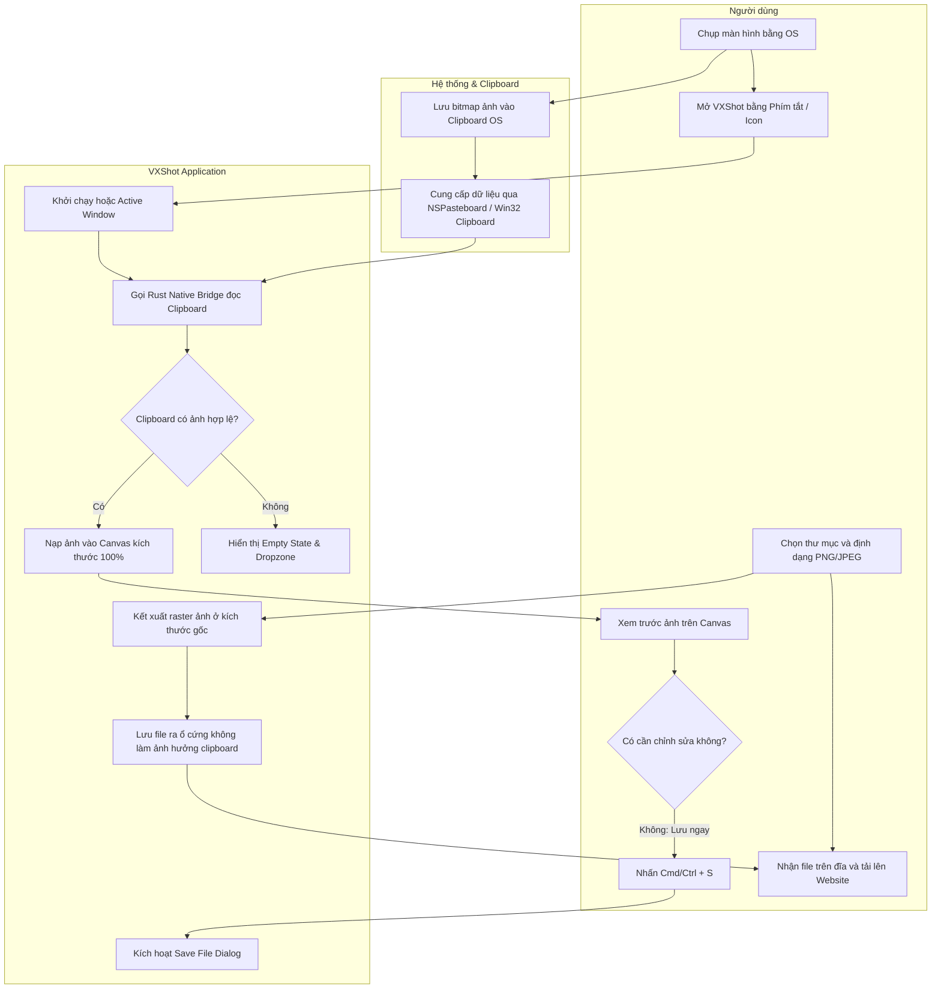
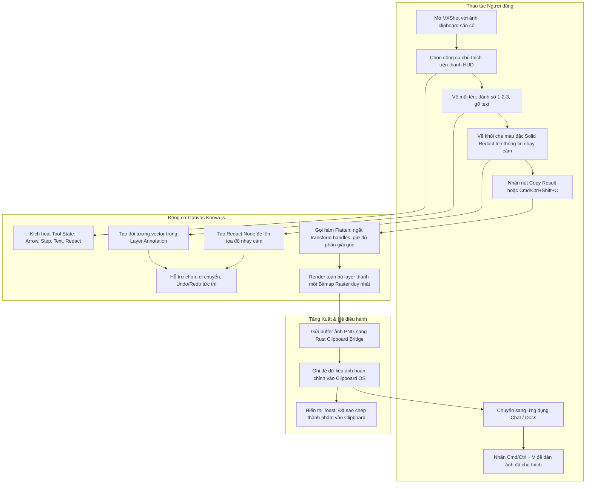
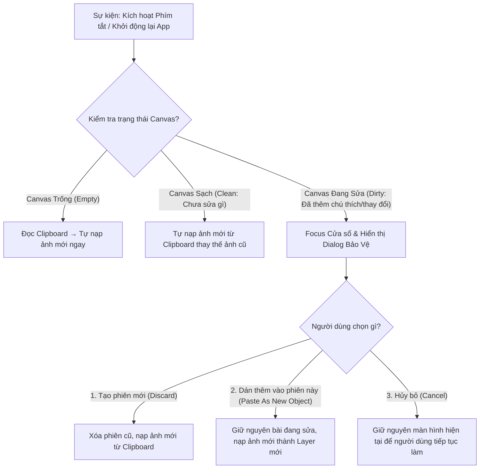

# 01. Quy trình Nghiệp vụ & Vận hành — VXShot (`_spec1_business_process`)

> **Tên sản phẩm:** VXShot (Cross-platform Quick Clipboard Image Editor & Annotator)  
> **Thư mục tài liệu:** `vxshot/docs/spec/`  
> **Phiên bản:** 1.0.0  
> **Ngày cập nhật:** 2026-10-27  
> **Tài liệu liên quan:** [00_system_overview.md](00_system_overview.md) | [VXShot_Scope_v1.0.md](../../VXShot_Scope_v1.0.md)

---

## 1. Sơ đồ SIPOC Tổng quan (Suppliers - Inputs - Process - Outputs - Customers)

Bảng phân tích SIPOC bóc tách toàn diện các tác nhân, dữ liệu đầu vào, chuỗi xử lý nghiệp vụ, đầu ra và đối tượng thụ hưởng của VXShot:

```text
┌────────────────────────────────────────────────────────────────────────────────────────┐
│                                   SƠ ĐỒ SIPOC VXSHOT                                   │
├───────────────┬───────────────────┬────────────────────┬──────────────────┬────────────┤
│ Suppliers     │ Inputs            │ Process (Core)     │ Outputs          │ Customers  │
├───────────────┼───────────────────┼────────────────────┼──────────────────┼────────────┤
│ 1. Người dùng │ - Ảnh chụp màn    │ 1. Tự động nạp     │ - File ảnh PNG   │ - Lập trình│
│    (Dev, QA,  │   hình trong      │    ảnh từ          │   (trong suốt/   │   viên, kỹ │
│    Design,    │   clipboard       │    clipboard       │   bảo toàn alpha)│   sư QA    │
│    Văn phòng, │ - Thao tác phím   │ 2. Hiển thị khung  │ - File ảnh JPEG  │ - Designer,│
│    CSKH)      │   tắt toàn cục    │    canvas đối tượng│   (nền trắng     │   Product  │
│ 2. Hệ điều    │ - Tệp ảnh kéo thả │ 3. Chú thích vector│   chuẩn)         │   Manager  │
│    hành       │   hoặc mở file    │    & che thông tin │ - Ảnh kết quả    │ - Nhân viên│
│    (macOS /   │ - Lệnh dán ảnh    │ 4. Mở rộng canvas  │   đã flatten nằm │   văn phòng│
│    Windows)   │   bổ sung (Cmd+V) │    & ghép nhiều ảnh│   trong clipboard│ - Khách    │
│ 3. Ứng dụng   │ - Lựa chọn công   │ 5. Hợp nhất raster │ - Nhật ký phiên  │   hàng &   │
│    bên ngoài  │   cụ & màu sắc    │    (Flatten) và    │   không rò rỉ    │   đối tác  │
│    (Slack,    │ - Vị trí lưu tệp  │    xuất tệp/clipbrd│   dữ liệu cá nhân│   nhận ảnh │
│    Web form)  │   trên ổ cứng     │                    │                  │            │
└───────────────┴───────────────────┴────────────────────┴──────────────────┴────────────┘
```

---

## 2. Quy trình Nghiệp vụ Chi tiết (BPMN 2.0 & Swimlanes)

### 2.1. Quy trình 1: Lưu Nhanh Ảnh từ Clipboard thành Tệp (Quick Save Flow — UC-01)

Quy trình giải quyết tình huống người dùng cần tải ảnh lên trang web hoặc ứng dụng chỉ chấp nhận tệp tải lên (file upload form) mà không cho phép dán trực tiếp từ clipboard.

```text
Người dùng               Hệ điều hành / Clipboard          VXShot UI Shell            Rust Native Core
    │                                │                            │                           │
    │── Chụp màn hình                │                            │                           │
    │   (Cmd+Ctrl+Shift+4 trên Mac / │                            │                           │
    │    Win+Shift+S trên Windows) ─►│                            │                           │
    │   (Ảnh nạp vào clipboard)      │                            │                           │
    │                                │                            │                           │
    │── Mở VXShot (Icon / Hotkey) ──►│                            │                           │
    │                                │◄── Đọc clipboard image ────┼── invoke(read_clipboard) ─│
    │                                │── Trả về Base64 PNG RGBA ─►│                           │
    │                                │                            │                           │
    │                                │                            │── Tự động nạp lên Canvas  │
    │                                │                            │   (Zero-click Hydration)  │
    │                                │                            │                           │
    │── Nhấn Cmd/Ctrl + S ──────────►│                            │── Yêu cầu Save Dialog ───►│
    │                                │                            │                           │── Mở OS Native Dialog
    │                                │                            │                           │   (chọn nơi lưu & đuôi)
    │── Chọn thư mục & Lưu ──────────┼────────────────────────────┼──────────────────────────►│
    │                                │                            │                           │── Ghi tệp an toàn (Atomic Save
    │                                │                            │                           │   qua file staging tạm)
    │                                │                            │◄── Báo lưu thành công ────│
    │                                │                            │                           │
    │◄─ Hiển thị Toast thông báo ────┼────────────────────────────│                           │
    │   "Đã lưu: screenshot.png"     │                            │                           │
    │                                │                            │                           │
    │── Kéo tệp upload lên Website ──┴────────────────────────────┴───────────────────────────┴── Hoàn tất UC-01
```



---

### 2.2. Quy trình 2: Chú thích Nhanh & Sao chép Thành phẩm (Quick Annotate Flow — UC-02)

Quy trình giải quyết tình huống người dùng cần thêm nhanh chú thích (mũi tên, số thứ tự, vùng che nhạy cảm) rồi gửi ngay vào kênh chat (Slack, Telegram, Teams) mà không tạo rác tệp trên máy.



---

### 2.3. Quy trình 3: Mở rộng Canvas & Ghép nhiều Ảnh (Multi-Image Composition — UC-03)

Quy trình ghép 2 hoặc nhiều ảnh màn hình (ví dụ: so sánh trước/sau, chụp 2 đoạn hội thoại ghép chung):

```mermaid
graph LR
    subgraph Step1_Base [Bước 1: Nạp ảnh gốc]
        S1[Nạp ảnh đầu tiên từ Clipboard] --> S2[Canvas Frame tự khớp kích thước ảnh gốc]
    end

    subgraph Step2_Expand [Bước 2: Mở rộng Canvas]
        S2 --> S3[Người dùng kéo tay nắm mép Canvas để nới rộng không gian]
        S3 --> S4[Canvas Frame mở rộng, vùng thêm mang màu nền trong suốt hoặc theo theme]
    end

    subgraph Step3_Paste [Bước 3: Dán ảnh thứ hai]
        S4 --> S5[Chụp ảnh thứ hai từ bên ngoài]
        S5 --> S6[Nhấn Cmd/Ctrl + V trong VXShot]
        S6 --> S7[Động cơ tạo ImageNode thứ 2 độc lập]
        S7 --> S8[Tự do kéo thả, đổi kích thước, chỉnh Z-order lớp ảnh]
    end

    subgraph Step4_Export [Bước 4: Xuất thành phẩm ghép]
        S8 --> S9[Thêm chú thích liên kết giữa 2 ảnh]
        S9 --> S10[Xuất toàn bộ khung Canvas Frame thành một ảnh phẳng duy nhất]
    end
```



---

### 2.4. Quy trình 4: Quản lý Vòng đời Phiên & Bảo vệ Phiên Chưa Lưu (Session Lifecycle & Dirty State Guard)

Quy trình ngăn chặn việc mất mát dữ liệu khi người dùng kích hoạt app bằng phím tắt hoặc mở file mới khi phiên hiện tại đang chỉnh sửa dở dang:



---

## 3. Ma trận Quyết định & Luật Nghiệp vụ (Decision Matrices)

### 3.1. Ma trận 1: Xử lý Dữ liệu Đầu vào Clipboard (Input Ingestion Matrix)

| ID | Trạng thái Clipboard | Kiểu dữ liệu nhận diện | Hành vi của VXShot | Giao diện hiển thị |
| :--- | :--- | :--- | :--- | :--- |
| `INP_01` | Chứa ảnh bitmap hợp lệ | `image/png`, `CF_DIBV5`, `public.tiff` | Tự động nạp ảnh lên Canvas, kích thước canvas = kích thước pixel ảnh gốc. | Hiển thị ảnh đầy đủ, Fit to Window, thanh trạng thái báo kích thước. |
| `INP_02` | Chứa ảnh có kênh Alpha | PNG 32-bit RGBA hoặc TIFF trong suốt | Bảo toàn 100% kênh trong suốt, hiển thị nền checkered mờ phía sau. | Canvas hiển thị vùng trong suốt với caro mờ xám đen. |
| `INP_03` | Clipboard rỗng hoặc chứa text/link | `text/plain`, `text/html`, rỗng | Không nạp gì, giữ app ở trạng thái rảnh (Idle). | Hiển thị màn hình đón tiếp (Empty State) kèm icon Dropzone và hướng dẫn. |
| `INP_04` | Clipboard chứa tệp ảnh copy từ Finder/Explorer | URI list tệp đường dẫn cục bộ | Đọc đường dẫn tệp, nạp bitmap ảnh trực tiếp lên Canvas. | Tự nạp ảnh như ảnh bitmap thông thường. |
| `INP_05` | Clipboard chứa dữ liệu ảnh bị lỗi/hỏng | Corrupted image byte array | Bắt lỗi graceful, không crash app. | Hiển thị thông báo Toast: *"Không thể đọc định dạng ảnh từ clipboard"*. |

---

### 3.2. Ma trận 2: Định dạng Xuất Ảnh & Xử lý Nền (Export & Background Matrix)

| ID Định dạng | Thao tác | Vùng Canvas Trong Suốt | Nền Xuất Mặc Định | Cơ chế Nén / Tùy chọn |
| :--- | :--- | :--- | :--- | :--- |
| `EXP_PNG_FILE` | Lưu tệp `.png` | Có | **Trong suốt (Alpha)** | Lossless compression, giữ nguyên độ nét 100%. |
| `EXP_PNG_FILE` | Lưu tệp `.png` | Không (Ảnh lấp đầy) | Theo ảnh gốc | Lossless compression. |
| `EXP_JPG_FILE` | Lưu tệp `.jpg` / `.jpeg` | Có | **Tự động áp Nền Trắng (`#ffffff`)** | Lossy compression chất lượng cao (`quality: 0.92`), nền trắng sạch sẽ. |
| `EXP_CLIPBOARD`| Sao chép `Copy Result` | Có / Không | **Giữ nguyên kênh Alpha trong PNG** | Đưa luồng PNG RGBA 32-bit vào clipboard OS để dán vào app khác không bị đen nền. |

---

### 3.3. Ma trận 3: Quy tắc Đánh số Thứ tự Tự động (Counter / Step Label Rules)

| Tình huống thao tác | Hành vi của Hệ thống | Trạng thái Bộ đếm |
| :--- | :--- | :--- |
| Click công cụ Step lần đầu | Đặt nhãn số tròn có số `1` tại vị trí chuột click. | Bộ đếm hiện tại = `1`, số tiếp theo = `2`. |
| Click công cụ Step các lần tiếp theo | Tự động tạo nhãn `2`, `3`, `4`... liên tiếp mà không cần gõ phím. | Tự động tăng thêm 1 sau mỗi lần click. |
| Xóa một nhãn bất kỳ (ví dụ xóa nhãn số `2` trong chuỗi 1, 2, 3) | **Không tự động đánh số lại** các nhãn còn lại (tuân thủ nguyên tắc Scope v1.0). | Nhãn 1 và 3 giữ nguyên; lần thêm mới tiếp theo sẽ lấy số lớn nhất hiện tại + 1. |
| Đổi màu hoặc kích thước nhãn | Áp dụng cho nhãn đang được chọn; nhãn tiếp theo tạo ra kế thừa thuộc tính này. | Giữ nguyên giá trị số của nhãn. |
| Bấm phím tắt Reset số đếm | Cho phép người dùng reset bộ đếm về `1` từ thanh thuộc tính nếu muốn bắt đầu chuỗi mới. | Bộ đếm tiếp theo = `1`. |

---

### 3.4. Ma trận 4: Chính sách Bảo vệ Dữ liệu Nhạy cảm (Redaction Security Policy)

| Phương pháp Che | Khuyến nghị của VXShot | Mức độ Bảo mật | Cơ chế Thực thi Kỹ thuật |
| :--- | :--- | :--- | :--- |
| **Khối Che Đặc (Solid Block)** | **Mặc định (Recommended)** | **Tuyệt đối (100%)** | Ghi đè ma trận điểm ảnh bằng màu đặc `#000000` hoặc `#ffffff`. Không thể đảo ngược hoặc dịch ngược bằng bất kỳ thuật toán AI nào. |
| **Làm Mờ (Blur Filter)** | Tùy chọn phụ (P1) | Tương đối (Có rủi ro) | Làm mịn cụm pixel; chỉ áp dụng cho hình ảnh minh họa thông thường, không khuyến khích cho mật khẩu hay số thẻ. |
| **Che Điểm Ảnh (Pixelate)** | Tùy chọn phụ (P1) | Tương đối (Có rủi ro) | Gom cụm khối vuông 8x8px; có khả năng bị tấn công brute-force từ điển ký tự. |

---

## 4. Điểm Nghẽn Vận hành, Rủi ro Đơn điểm (SPOF) & Kế hoạch Dự phòng

```text
┌────────────────────────────────────────────────────────────────────────┐
│                   RỦI RO VẬN HÀNH & KẾ HOẠCH DỰ PHÒNG                  │
├────────────────────┬──────────┬────────────────────────────────────────┤
│ Rủi ro / Điểm nghẽn│ Mức độ   │ Phương án Dự phòng / Giải pháp Kỹ thuật│
├────────────────────┼──────────┼────────────────────────────────────────┤
│ 1. Clipboard bị app│ Trung    │ Thử lại 3 lần với chu kỳ 50ms (Retry   │
│    khác khóa (Lock)│ bình     │ with backoff). Nếu vẫn khóa, hiển thị  │
│    khi đang đọc/ghi│          │ thông báo nhẹ nhàng cho người dùng.    │
├────────────────────┼──────────┼────────────────────────────────────────┤
│ 2. Ảnh kích thước  │ Nghiêm   │ Giới hạn kích thước tối đa 8192x8192px │
│    siêu lớn (8K/   │ trọng    │ (tối đa 33.2MP). Ngân sách RAM đệm tối │
│    100MB) gây tràn │          │ đa 200MB. Kiểm tra kích thước trước    │
│    RAM Webview     │          │ khi giải mã; giải phóng canvas cũ.     │
├────────────────────┼──────────┼────────────────────────────────────────┤
│ 3. Phím tắt toàn   │ Thấp     │ Bắt lỗi đăng ký phím tắt khi bị app    │
│    hệ thống bị     │          │ khác chiếm giữ; cho phép đổi phím tắt  │
│    trùng lặp       │          │ trong Settings mà không crash app.     │
├────────────────────┼──────────┼────────────────────────────────────────┤
│ 4. Lưu ảnh thất bại│ Trung    │ Kiểm tra quyền ghi thư mục trước khi   │
│    do quyền ổ cứng │ bình     │ lưu; hiển thị hộp thoại chọn thư mục   │
│    hoặc ổ đầy      │          │ khác nếu thư mục ban đầu bị cấm.       │
└────────────────────┴──────────┴────────────────────────────────────────┘
```
