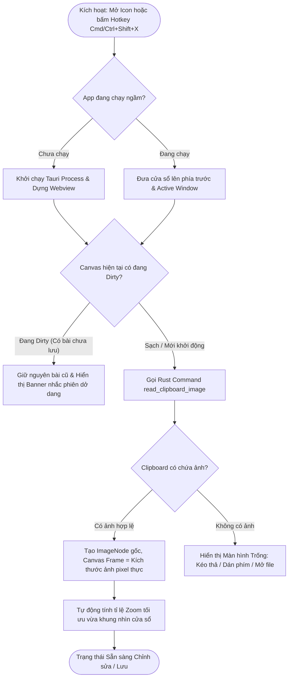
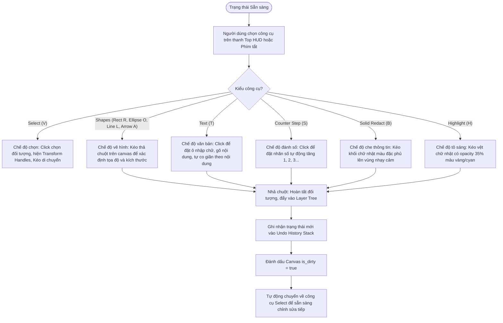
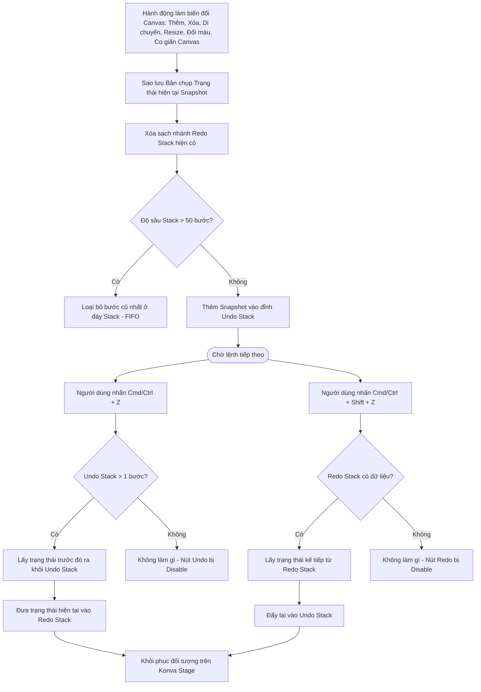
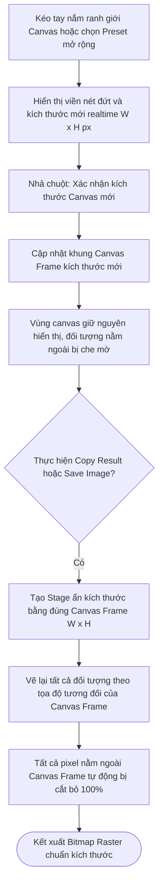
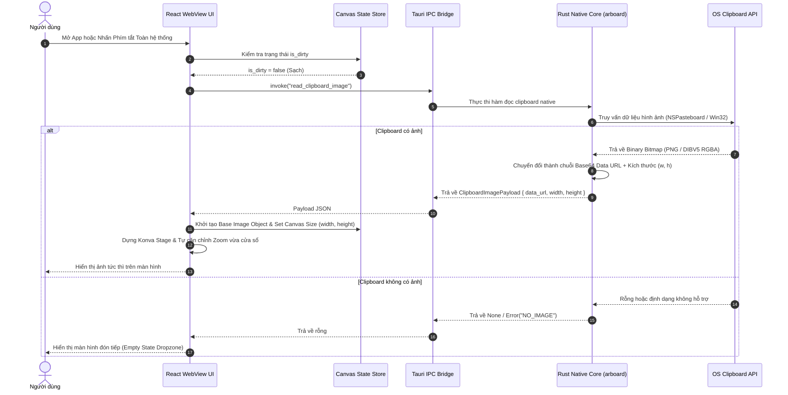
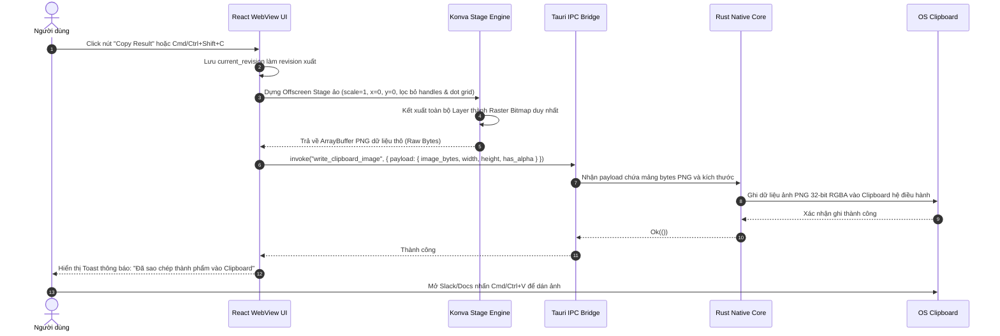
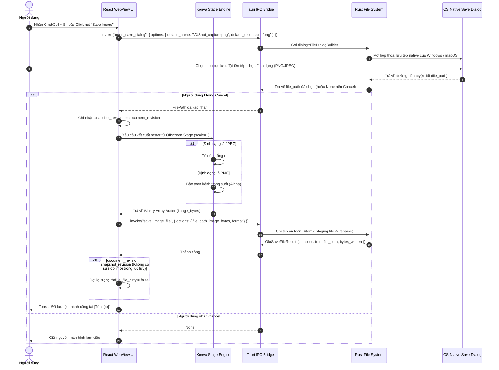
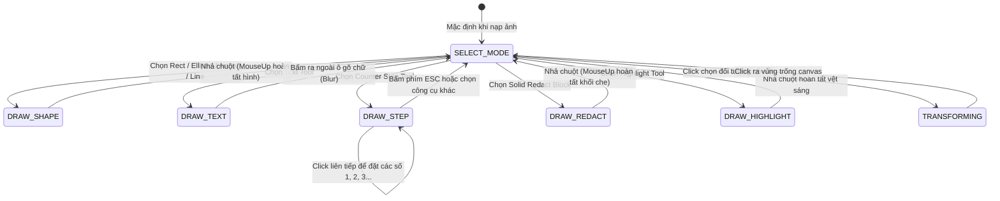

# 02. Luồng Tính năng & Logic Hệ thống — VXShot (`_spec2_feature_flow`)

> **Tên sản phẩm:** VXShot (Cross-platform Quick Clipboard Image Editor & Annotator)  
> **Thư mục tài liệu:** `vxshot/docs/spec/`  
> **Phiên bản:** 1.0.0  
> **Ngày cập nhật:** 2026-10-27  
> **Tài liệu liên quan:** [00_system_overview.md](00_system_overview.md) | [01_business_process.md](01_business_process.md) | [VXShot_Scope_v1.0.md](../../VXShot_Scope_v1.0.md)

---

## 1. Sơ đồ Luồng Người dùng Chi tiết (User Flow Diagrams)

### 1.1. Luồng 1: Khởi động Ứng dụng & Nạp Tự động từ Clipboard (App Activation & Hydration)



---

### 1.2. Luồng 2: Lựa chọn & Thao tác Công cụ Chú thích (Annotation & Tool Switching)



---

### 1.3. Luồng 3: Động cơ Lịch sử Thao tác (Undo / Redo Engine)



---

### 1.4. Luồng 4: Mở rộng Ranh giới Canvas & Cắt cúp Khi Xuất (Canvas Resize & Viewport Clipping)



---

## 2. Sơ đồ Tuần tự Hệ thống (System Sequence Diagrams)

### 2.1. Tuần tự 1: Đọc Ảnh Clipboard Native & Dựng Stage (Native Clipboard Read & Stage Hydration)



---

### 2.2. Tuần tự 2: Hợp nhất Toàn bộ Lớp & Ghi ngược vào Clipboard (Flatten & Copy Result)



---

### 2.3. Tuần tự 3: Lưu Ảnh Thành Phẩm Ra Ổ Cứng (Save Image File Flow)



---

## 3. Máy Trạng thái Hệ thống (Finite State Machines — FSM)

### 3.1. FSM 1: Vòng đời Ứng dụng & Trạng thái Phiên Làm Việc (Application Lifecycle FSM)

```text
┌────────────────────────────────────────────────────────────────────────┐
│               MA TRẬN CHUYỂN TRẠNG THÁI VÒNG ĐỜI ỨNG DỤNG              │
├─────────────────┬──────────────────────┬───────────────────────────────┤
│ Trạng thái Hiện │ Sự kiện Kích hoạt    │ Trạng thái Đích & Hành động   │
├─────────────────┼──────────────────────┼───────────────────────────────┤
│ `EMPTY_IDLE`    │ Đọc clipboard có ảnh │ → `IMAGE_LOADED` (Nạp ảnh gốc)│
│ `EMPTY_IDLE`    │ Kéo thả tệp vào app  │ → `IMAGE_LOADED` (Nạp tệp ảnh)│
├─────────────────┼──────────────────────┼───────────────────────────────┤
│ `IMAGE_LOADED`  │ Thêm chú thích / sửa │ → `EDITING_DIRTY`             │
│ `IMAGE_LOADED`  │ Bấm Cmd+S lưu ngay   │ → `SAVED_CLEAN` (Lưu ảnh gốc) │
│ `IMAGE_LOADED`  │ Bấm Copy Result      │ → `SAVED_CLEAN` (Ghi clipbrd) │
├─────────────────┼──────────────────────┼───────────────────────────────┤
│ `EDITING_DIRTY` │ Thêm / sửa đối tượng │ → `EDITING_DIRTY` (Push stack)│
│ `EDITING_DIRTY` │ Bấm Undo về bước đầu │ → `IMAGE_LOADED` (Hết dirty)  │
│ `EDITING_DIRTY` │ Bấm Cmd+S lưu tệp    │ → `SAVED_CLEAN` (Ghi đĩa OK)  │
│ `EDITING_DIRTY` │ Đóng app / Phím tắt  │ → `PROMPT_UNSAVED` (Hỏi user) │
├─────────────────┼──────────────────────┼───────────────────────────────┤
│ `SAVED_CLEAN`   │ Thêm chú thích mới   │ → `EDITING_DIRTY`             │
│ `SAVED_CLEAN`   │ Mở ảnh mới hoàn toàn │ → `IMAGE_LOADED` (Thay ảnh)   │
└─────────────────┴──────────────────────┴───────────────────────────────┘
```

---

### 3.2. FSM 2: Máy Trạng thái Công cụ Biên tập (Editor Tool FSM)



---

## 4. Giao ước Thực thi Dành cho AI Dev Agents (Machine-Readable Logic Contracts)

### Contract 1: `hydrate_from_clipboard`
- **Mục tiêu:** Tự động đọc và nạp ảnh từ clipboard khi mở app hoặc kích hoạt phím tắt.
- **Tiền điều kiện (Pre-conditions):** Cửa sổ app đang active VÀ `canvas_state.is_dirty == false`.
- **Các bước thực thi (Execution Logic):**
  1. Gửi lệnh IPC `invoke("read_clipboard_image")`.
  2. Nếu trả về `Result::Ok(payload)`:
     - Tạo một `ImageNode` với `id: "base_image"`, `x: 0`, `y: 0`, `width: payload.width`, `height: payload.height`, `src: payload.data_url`.
     - Cập nhật `canvas_state.width = payload.width`, `canvas_state.height = payload.height`.
     - Xóa sạch danh sách annotations hiện tại.
     - Đặt `canvas_state.is_dirty = false`.
     - Tính toán `zoom_level = calculate_fit_zoom(window_width, window_height, payload.width, payload.height)`.
  3. Nếu trả về `Result::Err(_)`:
     - Chuyển `canvas_state.view_mode = "EMPTY"`.
- **Hậu điều kiện (Post-conditions):** Canvas hiển thị ảnh gốc ở chế độ Fit Zoom, thanh trạng thái hiển thị đúng kích thước ảnh.

---

### Contract 2: `paste_secondary_image`
- **Mục tiêu:** Dán thêm ảnh mới từ clipboard vào canvas hiện tại khi người dùng nhấn `Cmd/Ctrl + V`.
- **Tiền điều kiện (Pre-conditions):** App đang mở VÀ người dùng nhấn phím tắt Paste VÀ không có ô Text Input nào đang focus.
- **Các bước thực thi (Execution Logic):**
  1. Gọi IPC `invoke("read_clipboard_image")`.
  2. Nếu có ảnh:
     - Sinh `new_id = "img_" + uuid_v4()`.
     - Tính toán vị trí hiển thị: Đặt ở giữa khung nhìn hiện tại (Viewport Center) hoặc lệch `+30px` so với ảnh gần nhất.
     - Thêm `ImageNode` vào danh sách `canvas_state.images` với Z-index cao nhất.
     - Nếu ảnh dán có kích thước vượt ra ngoài ranh giới Canvas Frame hiện tại:
       - **Không tự ý mở rộng Canvas Frame** (tuân thủ Scope v1.0).
       - Hiển thị thông báo gợi ý: *"Ảnh dán vượt ngoài ranh giới. Kéo tay nắm canvas để mở rộng vùng hiển thị."*
     - Chọn ngay ảnh mới dán và bật `Transformer` handles để người dùng co giãn/di chuyển.
     - Đặt `canvas_state.is_dirty = true`.
     - Đẩy bản chụp vào `undo_stack`.
- **Hậu điều kiện (Post-conditions):** Ảnh mới trở thành một đối tượng độc lập, có thể chỉnh sửa riêng biệt.

---

### Contract 3: `export_flattened_image`
- **Mục tiêu:** Kết xuất toàn bộ đối tượng thành một ảnh raster duy nhất theo đúng pixel gốc của Canvas Frame, độc lập 100% với mức zoom/pan của màn hình hiển thị.
- **Tiền điều kiện (Pre-conditions):** `target in ["CLIPBOARD", "FILE"]` VÀ `canvas_state.width > 0` VÀ `canvas_state.height > 0`.
- **Các bước thực thi (Execution Logic):**
  1. Ghi nhận `export_revision = canvas_state.document_revision`.
  2. **Đường nhanh Phase 1 (Phase 1 Fast-Path):**
     - Nếu `canvas_state.annotations.length == 0` VÀ `canvas_state.images.length == 1` VÀ chưa thay đổi kích thước canvas:
       - Trích xuất trực tiếp buffer bitmap gốc từ `base_image`, chuyển đổi sang định dạng mong muốn mà không cần dựng stage ảo.
  3. **Đường dựng Stage Cách Ly (Phase 2 & 3 Isolated Offscreen Stage):**
     - Dựng một cây DOM Konva Stage ảo (Offscreen Stage) hoàn toàn độc lập với stage màn hình chính:
       - Cấu hình cố định: `x: 0`, `y: 0`, `scaleX: 1`, `scaleY: 1`.
       - Kích thước đúng bằng Canvas Frame: `width: canvas_state.width`, `height: canvas_state.height`.
     - Sao chép toàn bộ danh sách `ImageNode` và `AnnotationNode` sang stage ảo (loại bỏ hoàn toàn transformer handles, viền chọn, dot grid và overlay vùng ngoài).
     - Áp dụng `SolidRedactNode`: Ghi đè màu đặc (alpha 255) trực tiếp lên ma trận điểm ảnh.
     - Nếu định dạng xuất là `"JPEG"`: Đặt lớp nền đáy là màu trắng (`#ffffff`), áp dụng chất lượng nén `0.92`.
     - Nếu định dạng xuất là `"PNG"`: Bảo toàn kênh trong suốt (Alpha 32-bit).
  4. Gọi hàm kết xuất raster: `offscreen_stage.toBlob({ mimeType: format_mime, pixelRatio: 1 })`.
  5. Chuyển Blob thành mảng bytes thô (`Uint8Array` / `Vec<u8>`).
  6. Nếu thao tác là `"CLIPBOARD"`:
     - Gọi IPC `invoke("write_clipboard_image", { payload: { image_bytes, width, height, has_alpha } })`.
     - Hiển thị toast: *"Đã sao chép thành phẩm vào Clipboard"*. (Lưu ý: Không xóa cờ `is_file_dirty` vì file trên đĩa vẫn chưa được lưu).
  7. Nếu thao tác là `"FILE"`:
     - Gọi IPC `invoke("save_image_file", { options: { file_path, image_bytes, format } })`.
     - Sau khi nhận kết quả `SaveFileResult::success`:
       - Nếu `canvas_state.document_revision == export_revision` (người dùng không thực hiện thêm thao tác mới trong lúc đang mở dialog lưu): Đặt `canvas_state.is_file_dirty = false`.
  8. Giải phóng hoàn toàn `offscreen_stage` trong khối `finally` để thu hồi bộ nhớ GPU/RAM.
- **Hậu điều kiện (Post-conditions):** Ảnh raster hoàn chỉnh được xuất ra chuẩn kích thước pixel gốc, ma trận điểm ảnh bị che được phá hủy vĩnh viễn, không rò rỉ bộ nhớ.


## Baseline phát hành 1.0.0 — QA độc lập 2026-10-27

- Phạm vi thực tế: một ảnh PNG/JPEG nền + annotation Canvas2D, zoom/pan, undo/redo, PNG/JPEG save và copy bitmap. Clipboard/file engine Rust dùng chung macOS/Windows. Multi-image, crop/resize/transform handles và sửa đối tượng sau tạo chưa triển khai; các mục đó trong thiết kế là roadmap, không thuộc nghiệm thu1.0.0.
- Focus/global shortcut không thay ảnh đã mở. Chỉ tự hydrate canvas trống khi bật auto-hydrate; đọc lại settings trước lần đầu. Paste/Open chủ động hỏi xác nhận nếu annotation khác snapshot vừa Save/Copy; stale clipboard results bị bỏ. Native dialog/focus không reset history.
- Save/Copy chụp snapshot annotation, chặn updater trước download nếu còn thay đổi chưa xuất hoặc thao tác đang chạy. Solid redaction vẽ lại ở pass cuối (cả preview/export), làm tròn ra ngoài pixel; mosaic lấy ảnh gốc không được phủ ngược lên vùng che. Màu đen opaque giữ nguyên.
- File input/export decode giới hạn8192px/33.2MP,64MiB encoded/256MiB decode allocation. Save kiểm format, dùng tempfile create-new cùng volume + sync + atomic persist, cleanup khi lỗi; từ chối đích symlink/thư mục. Chọn PNG/JPEG theo extension trong dialog; file hỏng không ghi đè đích.
- Settings IPC dùng rename_all snake_case cho new_settings. Updates thật: startup check im lặng khi mạng lỗi, manual retry, available/download/install/restart; không tự install. Chỉ GitHub updater dùng mạng, không upload ảnh. Giữ com.vxshot.desktop, khóa updater riêng, SDK27.0, Win currentUser.
- Recent menu chưa hoạt động được ẩn; không báo đã có tính năng roadmap. QA runtime và CI/package/public ghi riêng ở release review/evidence.


## Hồi quy native 1.0.1 — chốt nét vẽ nhanh

NativeQA1.0.0 xác nhận Save/Cancel giữ annotation/history. Tuy nhiên kéo khối che nhanh có thể chỉ hiện preview mà không commit vào annotations, nên ảnh xuất không chứa mask. Dùng refs đồng bộ cho drawing/start/points/preview, nhận mouseup ở window và consume nét vẽ đúng một lần trước React render. Preview/history/export phải thống nhất; duplicate mouseup không thêm hai đối tượng. Không thay engine clipboard/file, app identity, updater key hoặc SDK.
