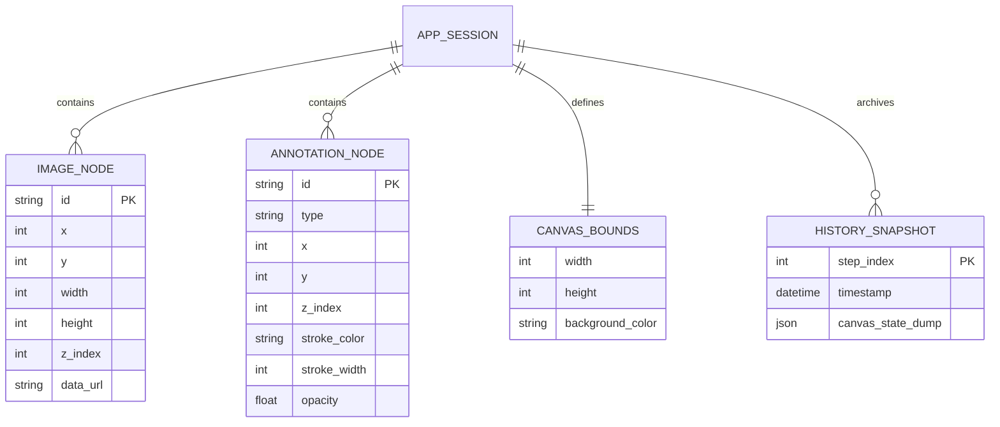

# 04. Đặc tả API & Kiến trúc Dữ liệu — VXShot (`_spec4_api_data`)

> **Tên sản phẩm:** VXShot (Cross-platform Quick Clipboard Image Editor & Annotator)  
> **Thư mục tài liệu:** `vxshot/docs/spec/`  
> **Phiên bản:** 1.0.0  
> **Ngày cập nhật:** 2026-10-27  
> **Tài liệu liên quan:** [00_system_overview.md](00_system_overview.md) | [02_feature_flow.md](02_feature_flow.md)

---

## 1. Giao thức IPC Contract (Tauri v2 Commands & Events)

Toàn bộ quá trình trao đổi thông tin giữa WebView Frontend (React 19 / TypeScript) và Native Core (Rust 2024) được thực hiện qua giao thức IPC an toàn kiểu dữ liệu (Type-Safe IPC) của Tauri v2.

### 1.1. Danh mục Tauri Commands & DTO Structs (Frontend Gọi Native Rust)

Tất cả các struct trao đổi dữ liệu qua IPC bắt buộc khai báo `#[serde(rename_all = "snake_case")]` để đồng nhất serialization giữa Rust và TypeScript.

```rust
// ==========================================
// CÁC STRUCT DTO TRAO ĐỔI IPC
// ==========================================

#[derive(Debug, Clone, Serialize, Deserialize)]
#[serde(rename_all = "snake_case")]
pub struct WriteClipboardPayload {
    pub image_bytes: Vec<u8>,
    pub width: u32,
    pub height: u32,
    pub has_alpha: bool,
}

#[derive(Debug, Clone, Serialize, Deserialize)]
#[serde(rename_all = "snake_case")]
pub struct SaveDialogOptions {
    pub default_name: String,
    pub default_extension: String,
}

#[derive(Debug, Clone, Serialize, Deserialize)]
#[serde(rename_all = "snake_case")]
pub enum ExportFormat {
    Png,
    Jpeg,
}

#[derive(Debug, Clone, Serialize, Deserialize)]
#[serde(rename_all = "snake_case")]
pub struct SaveFileOptions {
    pub file_path: String,
    pub image_bytes: Vec<u8>,
    pub format: ExportFormat,
}

#[derive(Debug, Clone, Serialize, Deserialize)]
#[serde(rename_all = "snake_case")]
pub struct SaveFileResult {
    pub success: bool,
    pub file_path: String,
    pub bytes_written: usize,
}

// ==========================================
// 1. NHÓM ĐỌC / GHI CLIPBOARD NATIVE
// ==========================================

#[tauri::command]
pub async fn read_clipboard_image(
    state: State<'_, AppState>
) -> Result<Option<ClipboardImagePayload>, String>;
// Đọc ảnh bitmap từ clipboard OS (Hỗ trợ 32-bit RGBA trên Windows và TIFF/PNG trên macOS).
// Trả về None nếu clipboard không chứa dữ liệu ảnh.

#[tauri::command]
pub async fn write_clipboard_image(
    payload: WriteClipboardPayload,
    state: State<'_, AppState>
) -> Result<(), String>;
// Ghi đè ma trận điểm ảnh PNG hoàn chỉnh vào clipboard OS phục vụ thao tác "Copy Result".

// ==========================================
// 2. NHÓM HỘP THOẠI & LƯU TỆP HỆ THỐNG
// ==========================================

#[tauri::command]
pub async fn open_save_dialog(
    options: SaveDialogOptions,
    app: AppHandle
) -> Result<Option<String>, String>;
// Kích hoạt hộp thoại chọn nơi lưu tệp native của Windows / macOS. Trả về đường dẫn tuyệt đối.

#[tauri::command]
pub async fn save_image_file(
    options: SaveFileOptions,
    state: State<'_, AppState>
) -> Result<SaveFileResult, String>;
// Ghi tệp an toàn nguyên khối (Atomic Save qua staging file .vxshot_staging_xxx -> rename) xuống đĩa cứng.

#[tauri::command]
pub async fn open_file_dialog(
    app: AppHandle
) -> Result<Option<ClipboardImagePayload>, String>;
// Mở hộp thoại chọn file ảnh từ máy (PNG, JPG, WebP) khi người dùng bấm nút Open File.

// ==========================================
// 3. NHÓM CẤU HÌNH & PHÍM TẮT TOÀN CỤC
// ==========================================

#[tauri::command]
pub async fn get_app_settings(
    state: State<'_, AppState>
) -> Result<AppSettings, String>;
// Đọc tệp cấu hình JSON từ thư mục chuẩn của OS (~/.config/vxshot/config.json).

#[tauri::command]
pub async fn save_app_settings(
    new_settings: AppSettings,
    state: State<'_, AppState>
) -> Result<(), String>;
// Lưu cấu hình mới xuống đĩa và cập nhật runtime state.

#[tauri::command]
pub async fn register_global_shortcut(
    shortcut_str: String,
    app: AppHandle
) -> Result<(), String>;
// Đăng ký lại phím tắt toàn hệ thống mở/hiện app (mặc định: "CmdOrCtrl+Shift+X").
```

---

### 1.2. Danh mục Tauri Events (Native Rust Bắn Sang Frontend)

| Tên Event | Chiều gửi | Dữ liệu kèm theo (Payload) | Mô tả kích hoạt |
| :--- | :--- | :--- | :--- |
| `vxshot://shortcut-triggered` | Rust → UI | `{ "timestamp": 1793084729 }` | Người dùng vừa nhấn phím tắt toàn hệ thống khi app đang chạy ngầm. |
| `vxshot://clipboard-changed` | Rust → UI | `{ "has_image": true }` | Clipboard OS vừa có nội dung mới là hình ảnh. |
| `vxshot://window-focused` | Rust → UI | `{ "is_focused": true }` | Cửa sổ app vừa nhận focus trở lại. |

---

## 2. Mô Hình Dữ Liệu & JSON Schemas

### 2.1. Payload Ảnh Clipboard (`ClipboardImagePayload`)

```json
{
  "$schema": "http://json-schema.org/draft-07/schema#",
  "title": "ClipboardImagePayload",
  "type": "object",
  "properties": {
    "data_url": {
      "type": "string",
      "description": "Chuỗi Data URL base64 định dạng image/png"
    },
    "width": {
      "type": "integer",
      "minimum": 1,
      "description": "Chiều rộng pixel vật lý thực tế của ảnh"
    },
    "height": {
      "type": "integer",
      "minimum": 1,
      "description": "Chiều cao pixel vật lý thực tế của ảnh"
    },
    "has_alpha": {
      "type": "boolean",
      "description": "True nếu ảnh chứa kênh trong suốt Alpha"
    }
  },
  "required": ["data_url", "width", "height", "has_alpha"]
}
```

---

### 2.2. Trạng Thái Khung Vẽ Toàn Bộ (`CanvasState`)

```json
{
  "$schema": "http://json-schema.org/draft-07/schema#",
  "title": "CanvasState",
  "type": "object",
  "properties": {
    "width": {
      "type": "integer",
      "description": "Chiều rộng khung Canvas Frame xuất ảnh (pixels)"
    },
    "height": {
      "type": "integer",
      "description": "Chiều cao khung Canvas Frame xuất ảnh (pixels)"
    },
    "background_color": {
      "type": "string",
      "description": "Mã màu nền (mặc định 'transparent' hoặc '#ffffff')"
    },
    "document_revision": {
      "type": "integer",
      "description": "Bộ đếm phiên bản thay đổi (tự tăng sau mỗi thao tác thêm/sửa/xóa)"
    },
    "is_file_dirty": {
      "type": "boolean",
      "description": "True nếu có thay đổi chưa được ghi xuống tệp trên đĩa cứng"
    },
    "images": {
      "type": "array",
      "items": { "$ref": "#/definitions/ImageNode" }
    },
    "annotations": {
      "type": "array",
      "items": { "$ref": "#/definitions/AnnotationNode" }
    },
    "selected_id": {
      "type": ["string", "null"],
      "description": "ID của đối tượng đang được chọn và hiện transformer"
    }
  },
  "required": ["width", "height", "background_color", "document_revision", "is_file_dirty", "images", "annotations"],
  "definitions": {
    "ImageNode": {
      "type": "object",
      "properties": {
        "id": { "type": "string" },
        "x": { "type": "number" },
        "y": { "type": "number" },
        "width": { "type": "number" },
        "height": { "type": "number" },
        "rotation": { "type": "number" },
        "z_index": { "type": "integer" },
        "data_url": { "type": "string" }
      },
      "required": ["id", "x", "y", "width", "height", "z_index", "data_url"]
    },
    "AnnotationNode": {
      "type": "object",
      "properties": {
        "id": { "type": "string" },
        "type": { "type": "string" },
        "x": { "type": "number" },
        "y": { "type": "number" },
        "z_index": { "type": "integer" }
      },
      "required": ["id", "type", "x", "y", "z_index"]
    }
  }
}
```

---

### 2.3. Cấu Trúc Đối Tượng Hình Ảnh (`ImageNode`)

```typescript
export interface ImageNode {
  id: string;              // "base_img" hoặc UUID "img_123e4567"
  x: number;               // Tọa độ X tương đối so với Canvas Frame
  y: number;               // Tọa độ Y tương đối so với Canvas Frame
  width: number;           // Kích thước hiển thị hiện tại
  height: number;
  rotation: number;        // Góc xoay (độ, mặc định 0)
  z_index: number;         // Thứ tự hiển thị lớp xếp chồng (chia sẻ chung với annotations)
  data_url: string;        // Nguồn dữ liệu bitmap Base64
  natural_width: number;   // Kích thước pixel gốc của ảnh
  natural_height: number;
}
```

---

### 2.4. Cấu Trúc Đối Tượng Chú Thích Vector (`AnnotationNode`)

```typescript
export type AnnotationType = 
  | 'RECTANGLE'
  | 'ELLIPSE'
  | 'ARROW'
  | 'LINE'
  | 'PEN'
  | 'TEXT'
  | 'STEP_COUNTER'
  | 'HIGHLIGHT'
  | 'SOLID_REDACT'
  | 'BLUR_FILTER';

export interface BaseAnnotationNode {
  id: string;              // UUID "anno_987fcb12"
  type: AnnotationType;
  x: number;
  y: number;
  rotation: number;
  z_index: number;         // Cùng không gian z_index với ImageNode
  stroke_color: string;    // Mã màu hex: "#ef4444", "#06b6d4"...
  stroke_width: number;    // Độ dày nét: 2, 4, 8 px
  opacity: number;         // 1.0 cho hình đặc, 0.35 cho Highlight
}

// Chú thích Hình chữ nhật & Tô sáng
export interface RectAnnotationNode extends BaseAnnotationNode {
  type: 'RECTANGLE' | 'HIGHLIGHT';
  width: number;
  height: number;
  fill_color?: string;
  corner_radius?: number;  // Bo góc (mặc định 4px)
}

// Chú thích Hình Elip / Tròn
export interface EllipseAnnotationNode extends BaseAnnotationNode {
  type: 'ELLIPSE';
  radius_x: number;
  radius_y: number;
  fill_color?: string;
}

// Chú thích Mũi tên & Đường thẳng
export interface ArrowAnnotationNode extends BaseAnnotationNode {
  type: 'ARROW' | 'LINE';
  points: [number, number, number, number]; // [x1, y1, x2, y2]
  pointer_length?: number; // 10px
  pointer_width?: number;  // 8px
}

// Chú thích Vẽ tay tự do
export interface PenAnnotationNode extends BaseAnnotationNode {
  type: 'PEN';
  points: number[];        // Danh sách tọa độ liên tiếp [x1, y1, x2, y2, ...]
}

// Chú thích Nhãn số đếm tự động
export interface StepCounterAnnotationNode extends BaseAnnotationNode {
  type: 'STEP_COUNTER';
  step_number: number;     // 1, 2, 3...
  radius: number;          // Bán kính hình tròn (mặc định 14px)
  bg_color: string;        // Màu nền nhãn tròn
  text_color: string;      // Màu chữ số (thường là "#ffffff")
}

// Chú thích Văn bản gõ phím
export interface TextAnnotationNode extends BaseAnnotationNode {
  type: 'TEXT';
  text: string;            // Nội dung ghi chú
  font_size: number;       // 14, 18, 24, 32 px
  font_family: string;     // System UI Font
  font_weight: string;     // "bold" | "normal"
  fill_color: string;
}

// Khối Che Thông Tin Tuyệt Đối (Solid Redact — Bảo Mật Cao Cấp)
export interface SolidRedactNode {
  id: string;
  type: 'SOLID_REDACT';
  x: number;
  y: number;
  width: number;
  height: number;
  rotation: 0;             // Cố định 0 để đảm bảo che vuông góc chính xác, không hở góc
  z_index: number;
  fill_color: string;      // Bắt buộc: "#000000" hoặc "#ffffff", không được để trống
  opacity: 1.0;            // Bắt buộc 1.0 (100% đặc, không cho phép bán trong suốt)
  corner_radius: 0;        // Cố định 0 (không bo góc để không lộ pixel tại 4 góc)
}

// Bộ lọc Làm mờ phụ (P1)
export interface BlurFilterAnnotationNode {
  id: string;
  type: 'BLUR_FILTER';
  x: number;
  y: number;
  width: number;
  height: number;
  z_index: number;
  blur_radius: number;     // Bán kính mờ (mặc định 10px)
}

// Union Type toàn bộ các dạng Annotations
export type AnnotationNode = 
  | RectAnnotationNode 
  | EllipseAnnotationNode 
  | ArrowAnnotationNode 
  | PenAnnotationNode 
  | TextAnnotationNode 
  | StepCounterAnnotationNode 
  | SolidRedactNode 
  | BlurFilterAnnotationNode;
```

---

### 2.5. Cấu Trúc Cấu Hình Ứng Dụng (`AppSettings`)

```json
{
  "general": {
    "auto_hydrate_on_open": true,
    "fit_window_on_open": true,
    "theme": "dark",
    "language": "vi"
  },
  "hotkeys": {
    "global_open": "CmdOrCtrl+Shift+X",
    "quick_save": "CmdOrCtrl+S",
    "copy_result": "CmdOrCtrl+Shift+C",
    "undo": "CmdOrCtrl+Z",
    "redo": "CmdOrCtrl+Shift+Z"
  },
  "editor": {
    "default_export_format": "PNG",
    "jpeg_quality": 0.92,
    "jpeg_background": "#ffffff",
    "default_stroke_color": "#ef4444",
    "default_stroke_width": 4,
    "default_font_size": 18
  },
  "privacy": {
    "default_redact_mode": "SOLID_BLOCK",
    "solid_redact_color": "#000000"
  },
  "recent_files": [
    "/Users/vic/Downloads/sample_capture.png",
    "/Users/vic/Desktop/bug_report_header.png"
  ]
}
```

---

## 3. Sơ Đồ Thực Thể Quan Hệ (Entity Relationship Diagram — ERD)



---

## 4. Ma Trận Xử Lý Lỗi Hệ Thống (IPC Error Code Matrix)

| Error Code | Mô tả Kỹ thuật | Phản hồi JSON Chuẩn Hóa | Thông điệp Hiển thị Giao diện (Vi) |
| :--- | :--- | :--- | :--- |
| `ERR_CLIPBOARD_EMPTY` | Clipboard không có dữ liệu nào | `{"code":"ERR_CLIPBOARD_EMPTY"}` | *"Clipboard trống, chưa có dữ liệu."* |
| `ERR_CLIPBOARD_NO_IMAGE` | Clipboard chứa text hoặc file không phải ảnh | `{"code":"ERR_CLIPBOARD_NO_IMAGE"}` | *"Clipboard không chứa dữ liệu hình ảnh hợp lệ."* |
| `ERR_CLIPBOARD_LOCKED` | App khác đang khóa pasteboard/clipboard | `{"code":"ERR_CLIPBOARD_LOCKED"}` | *"Bộ nhớ tạm đang bận, vui lòng thử lại sau giây lát."* |
| `ERR_FILE_SAVE_PERMISSION` | Không có quyền ghi vào thư mục chọn | `{"code":"ERR_FILE_SAVE_PERMISSION"}` | *"Không có quyền ghi tệp vào thư mục này."* |
| `ERR_FILE_SAVE_DISK_FULL` | Ổ cứng hết dung lượng trống | `{"code":"ERR_FILE_SAVE_DISK_FULL"}` | *"Ổ đĩa đã đầy, không thể lưu tệp ảnh."* |
| `ERR_HOTKEY_CONFLICT` | Phím tắt toàn hệ thống đã bị app khác chiếm | `{"code":"ERR_HOTKEY_CONFLICT"}` | *"Phím tắt toàn cầu bị trùng với ứng dụng khác."* |
| `ERR_IMAGE_DIMENSION_LIMIT`| Ảnh vượt quá 16384x16384px | `{"code":"ERR_IMAGE_DIMENSION_LIMIT"}`| *"Kích thước ảnh vượt quá giới hạn phần cứng đồ họa."* |
